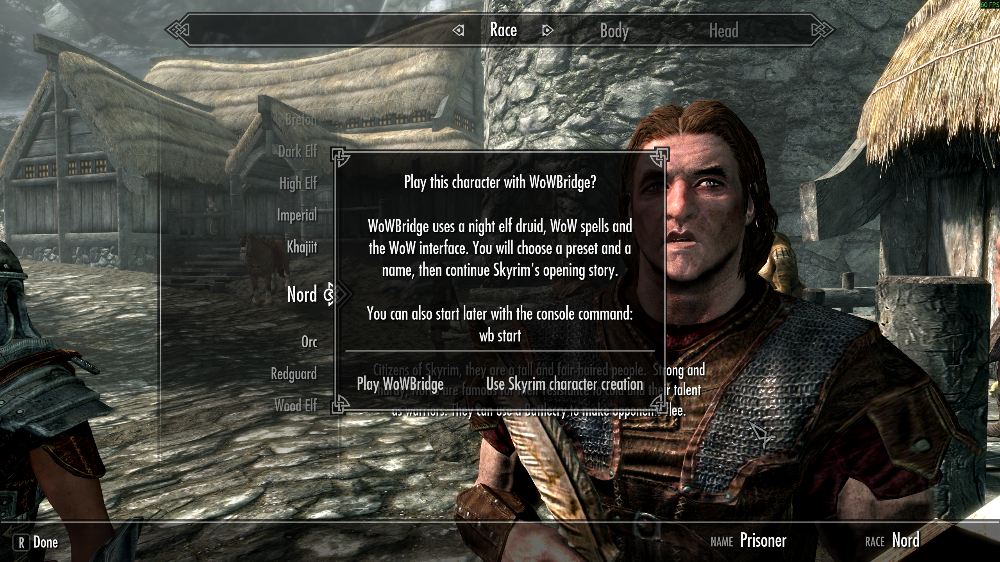
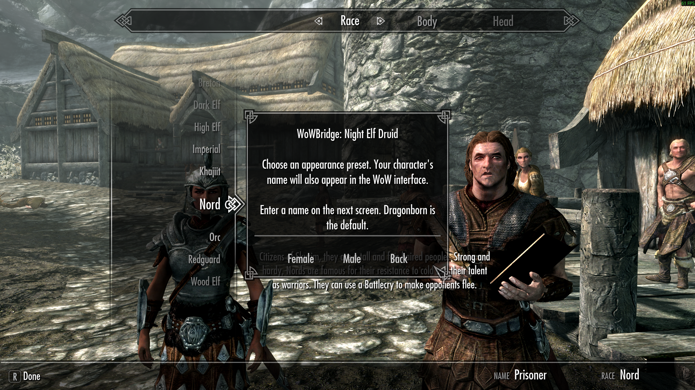
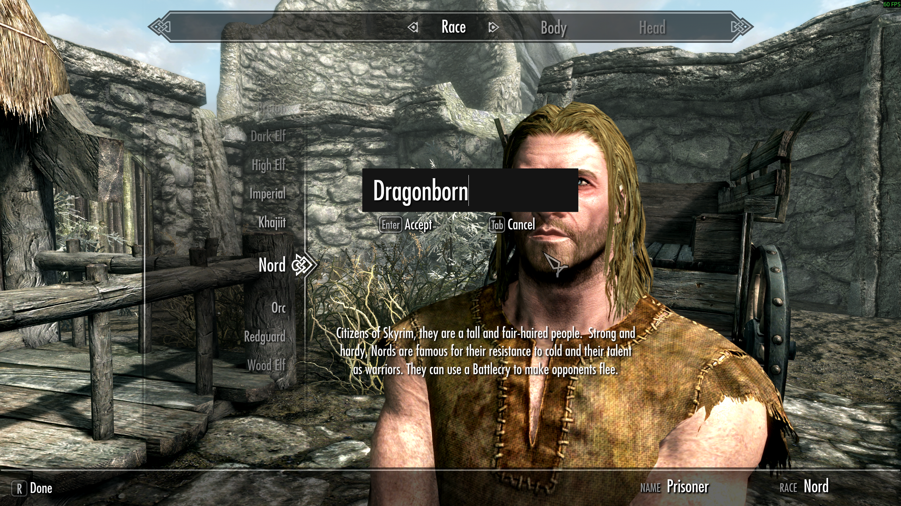
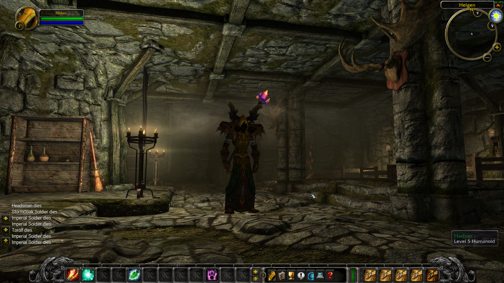

# WoWBridge

WoWBridge brings the look and feel of vanilla World of Warcraft into Skyrim Special Edition. It uses the WoW 1.12.1 interface, character models, animations and sounds alongside Skyrim's world, quests and NPCs. Combat runs through a local Python service based on CMaNGOS Classic formulas, with adjustments for Skyrim's skills and equipment.

The current build is for early testing. The default character is a night elf druid. There are working spells, forms, talents, equipment previews, bags, ground mounts and a WoW-style minimap. Skyrim's dialogue and merchant menus handle conversations and trade.

The project has been tested on Linux through Proton and Windows 11.

Much of the code is AI-generated. This project is for testing purposes only.<br>
No level of performance is warranted or guaranteed.

## Requirements

Download and install these yourself before running setup. Setup uses existing local files and makes no network requests.
None of these files are provided, sponsored, nor hosted by me. Download at your own risk.

| Requirement | Version or files needed |
| --- | --- |
| [Skyrim Special Edition](https://store.steampowered.com/app/489830/The_Elder_Scrolls_V_Skyrim_Special_Edition/) | The current build targets runtime **1.7.104.0**. Other runtimes have not been verified. |
| [Skyrim Script Extender, SKSE64](https://skse.silverlock.org/) | **2.3.1**, installed for that Skyrim runtime. Setup checks for its loader and runtime DLL. |
| [Address Library for SKSE Plugins](https://www.nexusmods.com/skyrimspecialedition/mods/32444?tab=files) | The matching library containing `versionlib-1-7-104-0.bin`. |
| [World of Warcraft vanilla client](https://archive.org/details/WoW_1.12.1-5875) | **1.12.1, build 5875**, enUS. Supply your own existing installation, keeping `WoW.exe` and `Data` together. |
| [CMaNGOS Classic source ZIP](https://github.com/cmangos/mangos-classic/archive/8ec338a1704e7dcb1c0213eb7ed58f9231ade40f.zip) | The pinned source version described below, extracted into a local folder. |
| [Visual C++ runtime, x64 download](https://aka.ms/vc14/vc_redist.x64.exe) | Microsoft Visual C++ v14 Redistributable. See [Microsoft's download page](https://learn.microsoft.com/en-us/cpp/windows/latest-supported-vc-redist). |
| [Python for Windows](https://www.python.org/downloads/windows/) or [other platforms](https://www.python.org/downloads/) | **3.10 or newer**. No additional Python packages are needed to play. |

The WoW client supplies the game's art, interface and client tables. WoW does not need to be open while playing Skyrim. A running WoW private server, database, account and server build tools are unnecessary for using the tester bundle.

For CMaNGOS, use [mangos-classic at commit `8ec338a1704e7dcb1c0213eb7ed58f9231ade40f`](https://github.com/cmangos/mangos-classic/tree/8ec338a1704e7dcb1c0213eb7ed58f9231ade40f). Its [source ZIP](https://github.com/cmangos/mangos-classic/archive/8ec338a1704e7dcb1c0213eb7ed58f9231ade40f.zip) contains `src/game/Entities/Unit.cpp`. Setup reads the resistance table from your local copy and saves the result locally. It does not compile or start CMaNGOS. A server package containing only executables will not provide this source file.

## Install

Download **WoWBridge-Tester.zip** from the [Releases page](https://github.com/kzx010/WoWBridge/releases) for playing. The GitHub source archive needs build outputs before setup can stage the mod.

1. Close Skyrim and extract the tester ZIP into a permanent, writable folder. Keep that folder because it contains the gameplay service and installation records.
2. On Windows, run `Setup.cmd`. You can also open a terminal in the extracted folder and run `py -3 setup.py`.
3. Enter the Skyrim folder containing `SkyrimSE.exe`, the WoW folder containing `WoW.exe`, and the extracted CMaNGOS source folder. If Address Library lives in a mod-manager folder, select its matching `.bin` file when prompted.
4. Setup validates the dependencies, extracts the resistance table and prepares a configured mod in `local/mod/WoWBridge`.
5. Choose one of the installation methods below.

### Direct installation

Run this from the tester folder:

```powershell
py -3 setup.py install
```

This copies WoWBridge into Skyrim's `Data` folder and adds `*WoWBridge.esp` to the standard `Plugins.txt`. It records the files it adds. If a destination already contains a different, untracked file, installation stops with the filename so you can resolve the conflict.

For a custom Skyrim profile, specify the plugin list that profile uses:

```powershell
py -3 setup.py install --plugins-txt "D:\Profiles\Skyrim\Plugins.txt"
```

### Mod manager

Add the configured `local/mod/WoWBridge` folder as a mod and enable `WoWBridge.esp`. You can ZIP the contents of that folder if your manager expects an archive. The ESP and `SKSE` directory belong at the archive root.

You can also have setup stage directly into a separate mod-manager folder with `--mod-dir`. Keep this staging folder separate from Skyrim's Data directory. Let the mod manager handle deploying and enabling the mod.

### Setup from the command line

All paths can be supplied together:

```powershell
py -3 setup.py configure --skyrim "D:\Games\Skyrim Special Edition" --wow-client "D:\Games\WoW" --cmangos "D:\Sources\mangos-classic"
```

Optional arguments:

| Argument | Purpose |
| --- | --- |
| `--address-library PATH` | Select the matching `.bin` file when it is installed outside Skyrim Data. |
| `--mod-dir PATH` | Choose where the configured mod folder is staged. |
| `--wow-client-windows PATH` | On Linux, supply the client path visible inside Wine or Proton. |

For example, on Linux:

```bash
python3 setup.py configure --skyrim "/games/Skyrim Special Edition" --wow-client "/games/WoW" --cmangos "/sources/mangos-classic" --wow-client-windows "Z:/games/WoW"
```

The Windows path must match your prefix's drive mappings. For direct installation on Linux, also pass the prefix's `Plugins.txt` path to `setup.py install`. Use your existing SKSE launch configuration in Steam or your mod manager.

## Play

1. Run `Start Service.cmd` on Windows, or `python3 setup.py service` on Linux. Keep the terminal open while playing.
2. Launch Skyrim through SKSE using your usual launcher or mod manager.
3. Start a new game or load a disposable test save.

### Start during character creation

Play the cart intro normally. When Skyrim opens character creation, choose **Play WoWBridge** in the popup.



Choose **Female** or **Male** for your night elf druid. **Back** returns to the first choice.



Enter a name and press **Enter** to accept. You can keep **Dragonborn**, the default. Your chosen name appears in the WoW interface.



Continue Skyrim's opening story. WoWBridge applies its appearance, equipment, controls and interface when the game gives you movement and combat control. The example below shows a named character in Helgen after activation.



### Start with a console command

On an existing character, or if you chose **Use Skyrim character creation**, open Skyrim's console with the grave accent key (`~` on a US keyboard) and enter:

```text
wb start
```

Close the console to use the preset popup, then choose **Female** or **Male**. Existing characters keep their Skyrim name, with **Dragonborn** as the fallback for an unnamed player. On a new game, the setup waits for character creation and activation waits for movement and combat control. Your choice is stored in the save. Existing WoWBridge saves keep their previous behavior.

Once you can move, use **W/A/S/D** to explore and hold the right mouse button to steer. Right-click nearby NPCs to talk or objects to interact. Press **P** to open the spellbook and drag spells onto the action bar, then use the numbered keys to cast. Press **B** for bags. The controls below cover targeting, forms and the other shortcuts. `wb` opens the testing panel, and `wb help` lists the console commands.

The gameplay service listens on `127.0.0.1:7878`. It needs no internet connection. Close its terminal with Ctrl+C after leaving Skyrim. Setup reports an occupied port instead of starting a second service.

Run `py -3 setup.py check` to check the selected local dependencies and gameplay data without launching Skyrim.

## Controls

These are the default keyboard and mouse controls during gameplay. Saved key bindings can differ. Mouse gestures over interface panels follow that panel's controls.

### Movement and camera

| Control | Action |
| --- | --- |
| W / S or Up / Down | Move forward / backward. |
| A / D or Left / Right | Turn left / right. While holding the right mouse button, these keys strafe instead. |
| Q / E | Strafe left / right. |
| Space or Numpad 0 | Jump. |
| Hold left mouse button and drag over the world | Rotate the camera. |
| Hold right mouse button and drag over the world | Steer your character. |
| Hold both mouse buttons over the world | Move forward until either button is released. |
| Mouse wheel | Zoom the camera in / out. |
| Num Lock | Toggle autorun. |
| Caps Lock or Numpad / | Toggle walking / running. Caps Lock uses Skyrim's native binding, unless rebound. |
| Tap Ctrl | Toggle sneak, including while moving, when your current form permits it. |
| Z | Draw / sheathe your weapon. |

### Targeting and world interaction

| Control | Action |
| --- | --- |
| Left-click an actor | Select that target. Left-click empty ground to clear it. |
| Tab | Cycle through nearby attackable targets in view. |
| Ctrl+Tab / Ctrl+Shift+Tab | Cycle forward / backward through nearby friendly followers in view. |
| F1 | Target yourself. |
| F2 through F5 | Target your first through fourth follower, when present. |
| Right-click an actor or object within reach | Talk, loot, open, harvest or take an item, depending on the target. Right-click a hostile actor to start attacking. |
| Alt+right-click an attackable actor | Start attacking, including friendly and neutral actors. |
| Alt+left-click a loose object within reach | Pick it up and hold it in the world. Move the mouse to position it horizontally. |
| Hold Alt while moving a held object | Raise or lower it while keeping its horizontal position. Release Alt to move it horizontally again. |
| Left-click while holding a world object | Release it. |

Right-click takes a loose item into your inventory; Alt+left-click holds it for positioning. Held objects stay within reach and obey collisions.

### Spells and action bars

| Control | Action |
| --- | --- |
| 1 through 9, 0, - and = | Use the twelve slots on the current action-bar page. Clicking a slot also uses it. |
| Alt plus an action-slot key | Use that slot on yourself when the spell supports it. |
| Shift+1 through Shift+6 | Switch action-bar pages. Shift+Up / Down or Shift+mouse wheel also cycle pages. |
| Ctrl+F1 through Ctrl+F10 | Activate the corresponding button on the shapeshift bar, when available. |
| Drag a spell from the spellbook onto a slot | Assign it to the action bar. Drag existing actions to rearrange an unlocked bar; Shift+click picks up an action even when the bar is locked. |
| Left-click the ground / right-click | Place / cancel a ground-targeted spell after selecting it. |
| Right-click a removable buff | Cancel it. Right-click the mount buff to dismount. |

The initial action bar includes Attack, Wrath, Moonfire, Rejuvenation, Healing Touch, Entangling Roots and Hurricane.

### Bags and loot

| Control | Action |
| --- | --- |
| B | Open / close all bags. F12 toggles the backpack; F8 through F11 toggle the other bags. |
| Right-click an item in a bag | Equip, unequip or use it, according to its tooltip. With a storage container open, store the stack. |
| Alt+right-click a bag item with a separate use effect | Activate that effect, as shown in its tooltip. |
| Shift+left-click a stack with chat closed | Choose how many items to split off. |
| Left-click or drag an item between bag slots | Pick up and move that stack. Place a split stack the same way. |
| Drop a bag stack over the world | Drop those items from your inventory. Right-click while carrying a bag stack on the cursor to cancel the move. |
| Drag a bag stack into an open storage container's loot window | Store that stack, including a split quantity. |
| Click an item in the loot window | Take it. Shift+click takes all available loot when chat is closed. |

### Menus and interface

| Control | Action |
| --- | --- |
| Shift+Tab | Open Skyrim's menu for Items, Magic, Skills and Map. |
| Escape | Close or cancel the active WoW interface panel or cursor action first. With nothing left to close, open Skyrim's pause menu. |
| C / K | Open the character / skills panel. |
| P / N | Open the spellbook / talents panel. |
| L | Open the WoW-style quest log containing your Skyrim quests. |
| M or Shift+M | Open Skyrim's map. |
| O | Open WoWBridge's testing panel. |
| V / Shift+V / Ctrl+V | Toggle enemy / friendly / all nameplates. |
| Alt+Z | Hide / show the WoW interface. |
| Enter or `/` | Open chat or begin a slash command. |
| Right-click a supported frame or its header | Choose Unlock Frame, then drag it with the left mouse button. Use the same menu to lock it again. |

Change ordinary bindings through the WoW interface's Key Bindings menu. Shift+Tab, Shift+M, the B all-bags shortcut and the world mouse gestures are handled separately. Skyrim's console remains on its usual key; `wb` opens the testing panel and `wb help` lists the available commands.

## Uninstall

Close Skyrim and the gameplay service first. For a direct installation, run `Uninstall.cmd` or:

```powershell
py -3 setup.py uninstall
```

Uninstall removes unchanged files recorded by setup and the plugin-list entry it added. It also removes unchanged files from the staged mod folder. Pre-existing files, files changed since installation, and the Skyrim, WoW, SKSE, Address Library and CMaNGOS installations are preserved. The command reports modified files it leaves behind.

For a mod-manager installation, disable and remove the mod through that manager before running setup's uninstall command to clear its staged files. Local settings and diagnostic logs remain in the tester folder. Delete that folder when you no longer need it, after dealing with any files reported as modified.

Keep the tester folder's `local` directory during upgrades so the installer can recognize its existing files. Rerun configure to update paths. A newer bundle should replace the bundle's supplied files while preserving `local`. Files edited outside setup are left for you to resolve.

## Building and project data

The native plugin is C++23 and uses CMake, CommonLibSSE-NG, Address Library, StormLib, Dear ImGui and the vendored WoWee/Lua runtime. The gameplay service uses Python's standard library. The current developer toolchain cross-compiles the DLL on Linux. The reference realm and data-generation tools are development dependencies.

After producing the native DLL, ESP, character, gear and catalog outputs, run `python tools/package.py` to assemble the Data-relative mod. `python tools/release.py` assembles a separate tester bundle containing the service, runtime data, local setup tools and a file-checksum manifest. Neither command fetches prerequisites. For the cached Linux developer toolchain, `python tools/rebuild_stormlib.py` rebuilds the existing StormLib release cache with portable source paths; source `tools/env.sh` first, then rebuild the plugin. The release packager rejects binaries containing local build paths.

The tester bundle excludes local configuration, logs, installation records and the extracted resistance table. Each tester generates that table during setup. Run `python tools/release.py --source-snapshot` to export the current source and user references. Game installations and machine-specific configuration are excluded.

## License

WoWBridge's original code is available under the [MIT License](LICENSE). Third-party components retain their existing terms in [licenses](licenses), including WoWee's restriction on use in commercial game products. The MIT license does not cover Skyrim or World of Warcraft assets.

## Credits

WoWBridge uses work from CMaNGOS Classic, WoWee, CommonLibSSE-NG, SKSE, StormLib, Dear ImGui, Lua and their contributors. Retained third-party license notices are in `licenses` and accompany the tester bundle. World of Warcraft and Skyrim belong to their respective owners.
